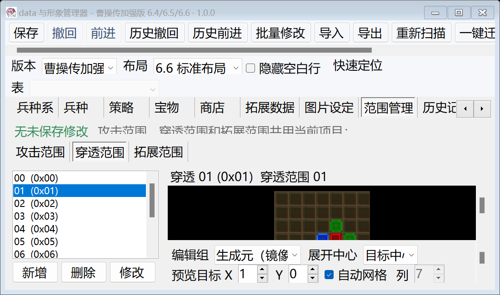
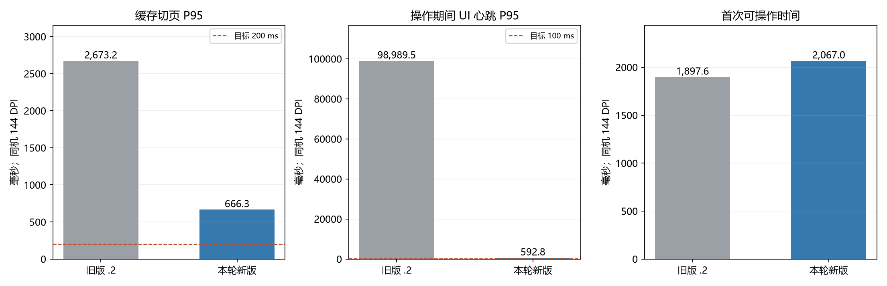
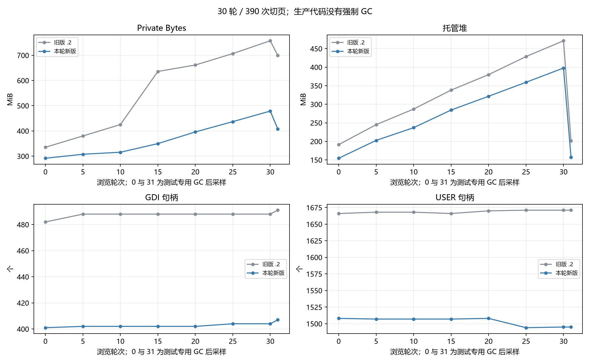
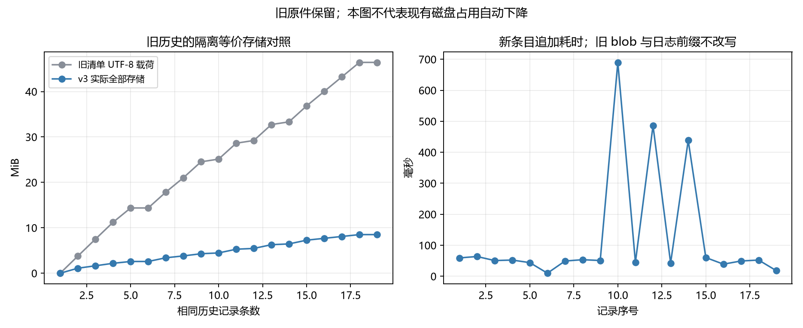

# Data 管理器 1.2026.1111.1 布局、性能与空间优化验收报告

本轮已实现稳定业务页宿主、合并布局调度、DPI/窄窗口约束、共享图像预算与有界优先队列、隐藏图库回收、绑定与物理投影列复用，以及保留全部旧历史的 history-v3。性能数值与未达标项均按实测保留，不将功能检查通过等同于性能目标达成。

**交付状态：优化候选版。** 最终布局专项通过（484/484），项目生命周期完成=True；切页/心跳/内存目标均按下表独立判断，尚未通过的项目继续明确保留。

## 构建与操作路径

- Windows x64、.NET 8、PerMonitorV2，实际宿主 DPI **144（150%）**。对照基线来自冻结的 1.2026.1110.2；最终性能样本构建为 `1.2026.1111.1+15a8984bf59bef82ec466f80e3e2be2386b55572`。
- 正式布局及性能测试使用同机 6.6 山贼基底的精确临时副本。基底 `Ekd5.exe`、根目录和 E5 子目录资源在前后核对完整 SHA-256；原文件未写入。6.4/6.5/6.6 范围与联合写入专项另有临时副本证据。最终旧版/新版均在F:临时目录串行测试，进程环境TEMP/TMP没有修改系统设置。早期C:接近满盘时的结果另行保留，不能把前后差异全部归因于代码；详情见`磁盘环境事件.md`和可用空间JSON。
- 布局：人物→兵种系→兵种→宝物→策略→商店→拓展数据→范围三个子页→人物物理表→图片→公式，逐项 A→B→A，至少 30 轮；尺寸 1100×650、1280×800、1920×1080，字体100/125/150%，真实最大化/还原、未完成文本/生成元/映射输入、可滚动范围控件。
- 性能：预热后同样 13 个场景，30 轮、390 次访问；后台每50ms投递 UI 心跳，记录操作过程中的实际等待。首次可操作与首图单列。两组主测串行执行；没有用强制 GC 改善生产行为。
- 压力测试使用实际WinForms窗体的离屏测试宿主，通过相同导航方法和消息循环驱动，并采集原生控件边界/截图；不是人工前台鼠标操作耗时。辅助功能客户端、机器负载、系统盘余量和GC高水位都可能影响原生消息处理，不承诺不同环境相同延迟。

## 已实现内容

1. `MainForm` 缓存业务页保持固定父容器，切换只调整显隐与激活；外层布局暂停期间直接设置目标导航状态。`IEditorViewLifecycle`/`LayoutScheduler` 合并尺寸、字体和DPI请求，失活页和旧版本回调不会继续布局；几何更新不重绑业务数据。拓展页按既有编辑器实例和文档版本复用，祖先隐藏造成的有效Visible=false不再触发隐藏/显示内部页及清理普通子页；原Flush校验继续执行。
2. 矩阵字体拟合与测量分离，尺寸/字体/DPI缓存失效，避免滚动条反馈和重复行列写入。范围预览按96 DPI比例计算，向上保留完整最小操作尺寸，窄窗口与工具栏可滚动访问。自动缩放继续启用。
3. E5预览档案128MiB LRU，合并并发读取，显式新鲜读取及完整写入校验保留；可回收像素共享96MiB预算，活动显示、在途解码和编辑候选单列。解码并发2、最多64个待处理任务，可见预览优先，按消费者淘汰过时请求，共享等待者取消相互隔离。
4. 大动画使用8帧/目标16MiB窗口；图库失活时回收卡片并取消缩略图，失活后的已排队尺寸/滚动回调也不能重建卡片。业务页还显式下传预览活动状态，停止隐藏动画、缩略图和范围预览；恢复使用原加载描述与选择，迟到结果须通过活动/版本检查。PNG/JPEG源条带及单个大画布仍可能产生短时大分配，预算不是进程总内存上限。
5. 业务页按相关文档版本复用实体绑定、查询和候选索引；物理投影列在签名不变时复用，避免反复释放大量原生辅助功能对象。堆快照进一步定位到原生ComboBox辅助功能provider→已释放SearchableIdComboBox→事件闭包→整页/工作区的强引用链；仅在控件正常Dispose完成后清理事件表和自定义事件，正常辅助功能继续保留。范围变更区分候选集合和几何预览，隐藏页延后处理，新增草稿仍可立即引用。
6. 数据和形象Core共用HistoryStorage：原始SHA去重、Brotli快速压缩/raw回退、独立blob、带序号和校验的追加日志、按需历史载荷。旧清单/快照/备份只读保留，旧记录状态更新追加到v3。新历史列表不用解码全部快照。
7. Prepare持久化后替换文件，复读验证后Commit，跨进程项目写锁，失败整组回滚，未知外部内容保留。普通保存仅将冻结字节的历史压缩移到后台；候选构建、文件替换、语义复读及图片编辑器的集成协调仍有同步阶段。
8. 新增所有权临时工作区：成功后核验身份/路径/链接并清理，失败保留证据。既有`.tmp`只生成只读清单，没有删除未知目录、用户历史或基底。

## 布局与功能验收

正式最终布局结果：**全部通过**。共484项、30轮、1279次导航；缓存业务页父容器变化0次，检查到216个可访问范围输入，原基底SHA未变：True。

前两轮 `layout-final-6.6` 和 `layout-delivery-6.6` 各有483/484项通过，分别在图片页、从人物物理表返回人物页时有一次10秒等待超时；中间10轮定位复测224项通过。主线程采样落在WinForms可见性传播/布局，未证明这类偶发长停顿的唯一根因。新增真实父级隐藏测试进一步确认：祖先隐藏后子页有效Visible已经false，但子页VisibleChanged没有触发，旧实现未回收28张卡片、未取消待处理请求。修复为直接观察所属祖先可见性/父容器变化并在Dispose解绑，隐藏/恢复及两种迟到请求专项随后通过。以上述最终正式结果为准；旧失败证据保留，不从历史中抹去。

项目循环早期先发现5个旧页存活，补充15秒静止复测仍有10个，显式预览停用后另有8个；最终定位堆快照的UIA事件引用链后修复。最终20次切换的76个退役页中仍存活0个，完成=True。保留失败JSON、持有链文本和最终弱引用检查，未通过延长等待或删除失败样本改判。原生辅助功能对象本身的释放时间由客户端及WinForms决定，有限测试不代表进程中所有原生对象均立刻销毁。

分页器复测前，`project-lifecycle-extend`再次发现2个已释放拓展页在15秒静止后仍存活。新的堆引用链为原生ComboBoxChildListUiaProvider→普通分页ComboBox（ExtendPage）→翻页事件闭包→ExtendDataEditorPanel→BusinessEditorPanel，区别于已经处理的SearchableIdComboBox。修复在分页控件正常Dispose通知后断开事件引用，覆盖局部重建和整页释放，保留辅助功能及正常翻页行为。失败快照的持有链文本与本轮最终结果均随报告保留；大型堆转储只保留在本地审计目录。

范围回归同时补上了异步历史恢复的验收等待：旧范围测试调用async void历史入口后立即比较文件，现通过仅测试通道的有界消息泵等待真实历史I/O结束，仍逐字节比较全部联合文件，并检查范围目录、字段引用和草稿。生产历史按钮继续异步执行。修正前失败日志`range-lifecycle-regression-async-wait-before.log`保留，不能以一次DoEvents返回视为后台恢复已结束。

| 专项 | 证据及结论 |
| --- | --- |
| 最终布局 | `layout-pager-6.6/layout-optimization.json`，全部通过 |
| 图像预算、调度、取消隔离、迟到释放 | `resource-lifecycle-delivery.log`，另有`resource-infrastructure-final.log`、`scheduler-priority-final.log` |
| 隐藏图库及恢复 | 最终专项包括父级隐藏/再次显示、失活但可见的排队回调、选择与滚动保持，见同上日志 |
| 业务页显式预览停用及释放引用 | `business-preview-regression-final.log`：停用但可见、祖先隐藏、子页返回、迟到结果、取消/像素/计时器、播放位置、未完成输入、新交互及直接Text赋值过期保护、未挂载零请求及已释放combo不保留owner通过 |
| 实际主窗项目切换 | `project-lifecycle-pager/project-lifecycle.json`，20次/120页，完成=True，退役业务页最终存活0；首次及有界静止采样完整保留 |
| 拓展页隐藏返回 | `extend-hidden-return-before.log`复现2次显隐、1次可见布局及普通子页清理；最终`extend-return-regression-final.log`修复后0次，控件/光标不丢，ID/文档版本/名称更新、无效输入验证、跨kind切换通过 |
| 普通分页器释放 | `extend-pager-lifecycle-before.log`在旧实现复现owner/editor仍存活；`extend-pager-lifecycle-final.log`验证正常翻页/按钮/实体及未完成输入，并故意保留整页释放或局部重建后的分页器，owner/editor均可回收且Disposed通知正常送达 |
| 范围候选即时引用 | 先前`range-catalog-final.log`通过；生命周期修改后的`range-owner-final.log`暴露了延迟恢复旧输入覆盖新Text赋值的回归，最终修复及三基底复测见`range-lifecycle-regression-final.log`。保留稀疏ID、未知原值、几何刷新、失败定位和草稿保持验证 |
| 范围整合与冲突/回滚 | `range-integration-regression-final.log`，三基底22项；同文件内存候选、原生/overlay重叠拒绝、事务末段故障回滚 |
| 实际顶部异步保存 | `history-async-mixed-regression-final.log`：新增攻击38/穿透12、4个业务引用、普通Data修改，Data/EXE/Hitarea/Effarea四文件同事务，重开及历史撤回/前进逐字节通过 |
| 历史v3 | `history-storage-v3-final.log`：压缩/raw复读、去重、旧格式按需读、残尾/校验/损坏blob、数据/图片恢复、外部冲突及锁 |
| 写回回归与投影列 | `writeback-projection-final.log`、`projected-column-reuse-final.log`：真实UI输入写回、排序过滤命令映射、隐藏草稿保存、30次同列对象复用 |
| 动画像素 | `resource-representative-frames-final.log`：Mcall38、Meff240、Weather20，代表首/末帧像素与源SHA一致 |
| 最终实际动画UI | `animation-lifecycle-delivery.log`：Weather四帧、Meff/Mcall播放、真实九个大动画逐项访问、1280/1920及字体100/125/150布局、原生像素平面回归通过 |
| 独立范围入口 | `published-range-selftest.json`：6.4/6.5/6.6识别、构建复读及模拟分支自测通过 |
| 最终发布资源/工作簿 | `published-data-resources-accepted.json`，16/16项，通过=True，真实源SHA记录见`published-data-original-sha.json` |
| 最近适用调色板 | `published-palette-final.json`9项通过：精确RGB优先、缺色最近距离、稳定等距处理及RAW复读；PNG保留原ARGB |

## 最终性能实测

| 指标 | 冻结旧版1.2026.1110.2 | 最终1.2026.1111.1 | 目标判定 |
| --- | ---: | ---: | --- |
| 预热切页P95 | 2673.2ms | 666.3ms | 降低75.1%；≤200ms且降低≥50%：未达到 |
| 切页中位数 | 148.9ms | 155.0ms | 单列实测，不替代P95 |
| 操作期间UI心跳P95 | 98989.5ms | 592.8ms | ≤100ms：未达到 |
| 原全审计范围心跳P95 | 98942.2ms | 585.9ms | 保留旧口径，包含循环后的截图、哈希与测试GC |
| 首次可操作 | 1897.6ms | 2067.0ms | 冷打开单列 |
| 首张可见图片 | 1898.6ms | 2068.0ms | 首图单列 |
| 浏览后Private Bytes（同样测试GC后） | 699.6MiB | 407.8MiB | 减少41.7%；≥25%：达到 |
| 浏览后GDI/USER（测试GC后） | 491/1671 | 407/1495 | 有限轮次，见原始曲线 |

最大单次切页为1362.3ms。最终最慢三项为：第23轮__ranges/0：选择1329.3ms、稳定等待33.0ms；第13轮拓展数据：选择873.7ms、稳定等待25.6ms；第8轮拓展数据：选择802.9ms、稳定等待86.8ms。稳定等待包含WinForms消息循环中的同步工作与采样，并非单独的几何计算计时。长停顿同时拖高操作期间心跳；本轮没有删掉这些离群值。解码队列耗时很短不能反证整个UI不卡顿。

最终旧版对照的最大单次等待为115833.4ms，显著拉高了该组心跳尾延迟，不能把巨大降幅外推为所有机器的通常收益。新版切页中位数和首次可操作时间没有改善，均在表中保留；本轮收益主要体现在本组尾延迟和浏览后内存。

最终基线和新版用同一份计时源码重建测试宿主。新增ActionHeartbeat按请求投递时所在区间分类，仅计30轮导航及循环内消息、几何快照采样；预热、截图、最终完整SHA和测试GC不在投递区间。末轮投递后迟到的回调继续计入，未以执行时的页面阶段删除真实长等待。原Heartbeat保留原范围，口径修正不作为代码性能收益。中间`after-owner-6.6`第30轮兵种系34秒停顿发生在操作循环内部，不能归因于尾部截图/GC污染。Settle的250ms是检查间软预算，无法抢占尚未返回的同步WinForms消息或快照调用；测试导航还沿用旧有事件导航加显式导航调用，不能将数字等同前台一次鼠标操作耗时。

以上GC仅发生在测试预热后与最终采样，未进行GC的轮次值与最终GC值分开绘图。生产代码没有循环Refresh、重建整页或强制GC。性能JSON的 `Passed` 表示该套件的功能/几何断言，并不校验200/100ms目标；本表独立判断是否达标。

早期默认C:临时目录的对照另行保留：切页P95 2799.1→755.0ms，心跳P95 19707.5→31465.2ms，测试GC后Private Bytes 604.2→495.4MiB。早期内存降幅仅18.0%。重复运行的环境/分配高水位会影响结果，最终对照在F:临时目录、追加业务预览修复后重做，不用其中更有利的单项替换另一组结果，也不将单次测量外推成所有机器的保证。

20次项目交替切换的Private Bytes：首198.6MiB、末448.5MiB、最终测试GC后246.0MiB；GDI 181→215、USER 612→695。有限20次结果不证明无限期稳定或零泄漏；出现的增长和句柄漂移如实保留。

测试GC后的最终GDI/USER仍为211/694，较首轮增加30/82。退役业务页全部回收解决了已定位的托管引用链，但不足以证明原生句柄长期稳定；该目标本轮未证明达到。

原始数据：`before-actions-6.6/optimization-audit.json`、`after-pager-6.6/optimization-audit.json`、`project-lifecycle-pager/project-lifecycle.json`。随版 `验收图表/` 提供响应时间、内存/GDI/USER、项目切换及历史增长图、SVG和CSV。资源统计保留排队数、活动解码数、完成/取消次数和像素分类计量：解码队列等待P95为1.65ms、最大7.61ms，解码执行P95为13.33ms、最大43.56ms。等待P95使用最近已开始任务的样本，执行P95使用最近已结束delegate的样本，各使用最近最多256个样本的有界窗口（本次保留等待样本231、执行样本231），总样本和最大值覆盖协调器生命周期；开始前取消/淘汰不计入解码耗时。性能脚本遵循原界面“记忆最近物理表”的导航行为，人物模块在物理表访问后会返回该物理表；布局专项则显式恢复业务视图以分别验收。

## 历史增长与空间

从一个真实19条历史的只读清单，在隔离临时目录逐条构造等价v3表示：原清单 **48,676,270B（46.42MiB）**，v3全部文件 **8,912,514B（8.50MiB）**，减少 **81.69%**。元数据列表8.00ms；全量等价转换3312.3ms；单条追加9.9～690.0ms。

每次追加均核对旧blob SHA及旧日志前缀不变；真实历史原件SHA不变。该对照证明新表示的增长收益，**未迁移或删除现有用户历史，升级不会立即释放原有46.42MiB**。`.tmp`只读清单约1424.739MiB，不代表运行内存泄漏；可复核条目附在发布资料，未擅自清理。

## 未达到目标和验证边界

- 切页P95目标：未达到；UI心跳P95目标：未达到；浏览后Private Bytes降低25%目标：达到。尚有同步保存阶段、大图源解码及原生控件布局开销，不宣称全部卡顿已消除。
- 20次项目循环后退役业务页全部回收，但原生GDI/USER仍有漂移，长期句柄稳定与无限期无增长目标未证明达到，不能以托管弱引用检查通过替代。
- 真实144 DPI已验证，额外字体放大仅测试字体传播；没有可用的真实跨屏DPI转换验收，不能以字体模拟替代。完整磁盘耗尽/真实断电未实测；使用实际文件锁、损坏blob、残尾及各类中断/迟到提交故障覆盖已实现的事务边界，不能把这些等同全部物理故障场景。
- 发生过真实C:空间不足，但失败发生在测试复制基底阶段，不是提交阶段，不能据此声称磁盘耗尽事务已验收。原失败副本逐文件SHA核对迁存至F:并全部保留。测试宿主截图标题可能显示宿主的1.0.0；最终EXE版本由发布资源报告和文件版本核对。
- `published-data-accepted.json`完整包检查为17/18，唯一未覆盖是缺少“内嵌24位真彩BMP Mcall”样本；最终资源/工作簿16项检查不包含该项及独立Weather动画专项。现有动画代表帧结果单列，不将缺样改成通过。
- `--extend-compatibility`在本版及冻结基线均失败于`ccz-6.4/64-xisui-v1`，属于本轮未修复的既有兼容性断言；见`binding-extend-compatibility.log`、`binding-baseline-compatibility.log`。其他通过项目不能覆盖该限制。
- 真实统计存档尾部版本4继续安全跳过，版本2正向使用受控临时夹具；没有新增版本4写回支持。图片编辑器的集成事务仍有同步阶段。
- 运行包依赖Windows x64和.NET 8 Desktop Runtime，约束与源码重建说明见使用说明；源码需要SDK/NuGet还原，未承诺离线重建。

## 交付和升级

交付两个程序、共享范围/图像/历史源码ZIP、使用说明、许可、验收报告、图表/CSV及布局截图。EXE/E5/CCZRNG02/CCZRNG03格式、编号及名称显示不变，未添加名称池或名称编辑。程序与源码SHA以随版`发布记录.json`为准，ZIP逐文件清单并做解压重建。

为延续既有历史，将新版程序放回原管理器目录并保留同级全部`项目名_历史记录`文件夹，项目路径保持不变；也可把历史文件夹完整复制至新目录。单独从版本子目录运行不自动读取父级历史。升级后的v3状态和新操作由新版负责恢复，不交替使用旧版写同一项目。

